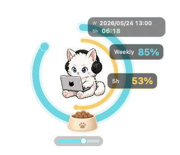

# Codex Pet Meter

Codex Pet Meter is an unofficial macOS helper app that shows Codex usage-limit rings around Codex Pet.

It does not change Codex or Codex Pet. It reads local Codex state on your Mac, draws a transparent overlay, and follows the current Codex Pet position and size.

## Start Here

1. Install and sign in to the Codex desktop app, then show Codex Pet on screen.
2. Download this repository to your Mac.
3. Open Terminal in this folder and run:

```bash
tools/install-hunger-meter.sh
```

After installation, `Pet Meter` appears in the macOS menu bar. The app also starts automatically when you log in.

To quit temporarily, choose `Quit` from the `Pet Meter` menu. To reopen it, open `Home > Applications > CodexPetHungerMeter.app` in Finder or search for `Pet Meter` in Spotlight.

## What It Shows

- Outer ring: weekly limit remaining
- Inner ring: 5-hour limit remaining
- Top badge: reset time information
- Food bowl: click to refresh usage data manually
- Size behavior: the rings automatically resize with Codex Pet
- Fine tuning: hover over the food bowl, then drag the small bar below it to adjust the ring scale

The percentages are remaining capacity, not used capacity.

Sample image:



The image uses sample percentages and reset times. It also shows the fine-tuning bar that appears below the food bowl on hover.

## Requirements

- macOS
- Xcode Command Line Tools
- Codex desktop app
- Codex Pet enabled and visible
- Your own Codex login on the same Mac

If your Mac asks to install command line developer tools, allow it. You can also install them manually:

```bash
xcode-select --install
```

## Downloading From GitHub

If you are not familiar with Git:

1. Open this repository on GitHub.
2. Click `Code`.
3. Click `Download ZIP`.
4. Unzip the file.
5. Open Terminal and move into the unzipped folder.
6. Run `tools/install-hunger-meter.sh`.

If you use Git:

```bash
git clone https://github.com/GrShin5/codex-pet-meter.git
cd codex-pet-meter
tools/install-hunger-meter.sh
```

## Ask Codex to Install It

If you are not comfortable using Terminal, give Codex this repository URL and ask it to set up the app for you.

Recommended prompt:

```text
Please install and set up this macOS Codex Pet Meter from the repository below:

https://github.com/GrShin5/codex-pet-meter

Please inspect the README first, install only from this repository, explain each step in plain language, run the verification script if possible, and do not print, copy, or upload any local tokens or Codex account files.
```

Codex should download or clone the repository, run `tools/install-hunger-meter.sh`, confirm that `Pet Meter` appears in the macOS menu bar, and explain how to uninstall it.

## Updating

If you installed with Git:

```bash
cd codex-pet-meter
git pull
tools/install-hunger-meter.sh
```

If you downloaded a ZIP, download the latest ZIP from GitHub again, unzip it, open Terminal in the new folder, and run:

```bash
tools/install-hunger-meter.sh
```

Reinstalling updates the app in `~/Applications/CodexPetHungerMeter.app` and reloads the login item.

## Uninstall

To remove everything installed by this tool:

```bash
tools/uninstall-hunger-meter.sh
```

This removes the login item, `~/Applications/CodexPetHungerMeter.app`, and the app preference domain. It does not delete or modify Codex, Codex Pet, your Codex login, or Codex local logs.

## Packaged ZIP

This repository can also create a distributable ZIP containing the built app:

```bash
scripts/package-release.sh
```

The ZIP is written to `dist/`. Generated app bundles and ZIP files are not committed to Git.

## Guides

- Japanese guide: [docs/user-guide.ja.md](docs/user-guide.ja.md)
- English guide: [docs/user-guide.en.md](docs/user-guide.en.md)
- Security notes: [SECURITY.md](SECURITY.md)
- Disclaimer: [DISCLAIMER.md](DISCLAIMER.md)

## Development

Build only:

```bash
tools/build-hunger-meter.sh
```

Run without installing:

```bash
tools/run-hunger-meter.sh
```

Verify:

```bash
tools/verify-hunger-meter.sh
```

The verifier builds the app, checks cached usage parsing, and creates `build/hunger-meter-preview.png`.

---

# Codex Pet Meter 日本語説明

Codex Pet Meter は、Codex Pet の周囲にCodex使用量の残量リングを表示するmacOS用の非公式補助アプリです。

Codex本体やCodex Petは変更しません。自分のMac上にあるCodexの状態を読み、透明なオーバーレイを表示して、現在のCodex Petの位置とサイズに追従します。

## まず最初に

1. Codexデスクトップアプリをインストールしてログインし、Codex Petを画面に表示します。
2. このリポジトリをMacにダウンロードします。
3. このフォルダでTerminalを開き、次を実行します。

```bash
tools/install-hunger-meter.sh
```

インストール後、macOSのメニューバーに `Pet Meter` が表示されます。ログイン時にも自動起動します。

一時的に終了する場合は、`Pet Meter` メニューから `Quit` を選んでください。もう一度起動する場合は、Finderで `ホーム > Applications > CodexPetHungerMeter.app` を開くか、Spotlightで `Pet Meter` と検索してください。

## 表示される内容

- 外側リング: Weeklyリミットの残量
- 内側リング: 5時間リミットの残量
- 上部バッジ: リセット時刻の情報
- フードボウル: クリックすると使用量データを手動更新
- サイズ追従: リングはCodex Petのサイズ変更に自動で追従
- 微調整: フードボウルにカーソルを合わせ、下に出る小さなバーをドラッグしてリングサイズを調整

表示されるパーセントは「使用済み」ではなく「残量」です。

サンプル画像:


画像内のパーセントとリセット時刻はサンプル値です。フードボウルにホバーしたときに下へ表示される微調整バーも示しています。

## 必要なもの

- macOS
- Xcode Command Line Tools
- Codexデスクトップアプリ
- Codex Petが有効で画面に表示されていること
- 同じMac上で自分のCodexアカウントにログインしていること

Macからコマンドライン開発者ツールのインストールを求められた場合は、許可してください。手動で入れる場合は次を実行します。

```bash
xcode-select --install
```

## GitHubからダウンロードする方法

Gitに慣れていない場合:

1. GitHubでこのリポジトリを開きます。
2. `Code` をクリックします。
3. `Download ZIP` をクリックします。
4. ZIPファイルを解凍します。
5. Terminalを開き、解凍したフォルダに移動します。
6. `tools/install-hunger-meter.sh` を実行します。

Gitを使う場合:

```bash
git clone https://github.com/GrShin5/codex-pet-meter.git
cd codex-pet-meter
tools/install-hunger-meter.sh
```

## Codexにインストールを任せる場合

Terminal操作に慣れていない場合は、CodexにこのリポジトリURLを渡して、セットアップを依頼できます。

コピー用プロンプト:

```text
以下のリポジトリから、macOS用のCodex Pet Meterをインストールしてセットアップしてください。

https://github.com/GrShin5/codex-pet-meter

まずREADMEを確認し、このリポジトリだけを使ってインストールしてください。各手順を初心者にも分かる言葉で説明し、可能であれば検証スクリプトも実行してください。ローカルのトークンやCodexアカウント関連ファイルは、表示・コピー・アップロードしないでください。
```

Codexには、リポジトリのダウンロードまたはclone、`tools/install-hunger-meter.sh` の実行、メニューバーに `Pet Meter` が表示されたことの確認、アンインストール方法の説明まで依頼してください。

## 更新方法

Gitでインストールした場合:

```bash
cd codex-pet-meter
git pull
tools/install-hunger-meter.sh
```

ZIPでダウンロードした場合は、GitHubから最新ZIPをもう一度ダウンロードして解凍し、新しいフォルダでTerminalを開いて次を実行します。

```bash
tools/install-hunger-meter.sh
```

再インストールすると、`~/Applications/CodexPetHungerMeter.app` が更新され、ログイン時自動起動の設定も読み込み直されます。

## アンインストール

このツールがインストールしたものをすべて削除する場合:

```bash
tools/uninstall-hunger-meter.sh
```

この操作では、ログイン時自動起動の設定、`~/Applications/CodexPetHungerMeter.app`、アプリ設定ドメインを削除します。Codex本体、Codex Pet、自分のCodexログイン、Codexのローカルログは削除・変更しません。

## 配布用ZIP

このリポジトリでは、ビルド済みアプリを含む配布用ZIPも作成できます。

```bash
scripts/package-release.sh
```

ZIPは `dist/` に作成されます。生成されたアプリ本体やZIPファイルはGitにはコミットしません。

## ガイド

- 日本語ガイド: [docs/user-guide.ja.md](docs/user-guide.ja.md)
- 英語ガイド: [docs/user-guide.en.md](docs/user-guide.en.md)
- セキュリティ説明: [SECURITY.md](SECURITY.md)
- 免責事項: [DISCLAIMER.md](DISCLAIMER.md)

## 開発

ビルドのみ:

```bash
tools/build-hunger-meter.sh
```

インストールせずに起動:

```bash
tools/run-hunger-meter.sh
```

検証:

```bash
tools/verify-hunger-meter.sh
```

検証スクリプトはアプリをビルドし、キャッシュされた使用量解析を確認し、`build/hunger-meter-preview.png` を作成します。
